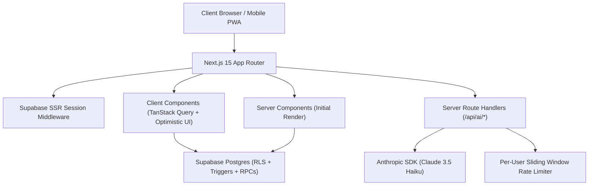
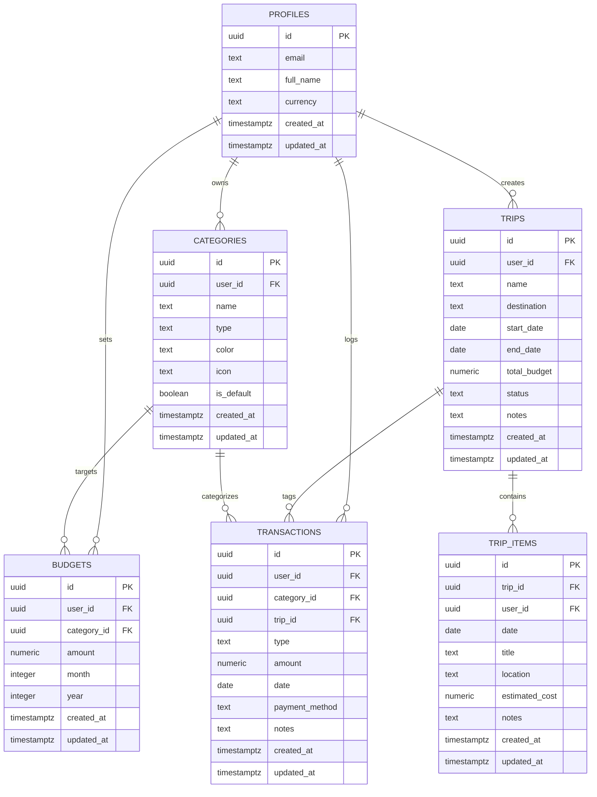

# Spendwise — Personal Finance & Travel Tracker

A complete, production-quality personal finance and travel management web application built with **Next.js 15 (App Router)**, **TypeScript**, **Tailwind CSS**, **Supabase (Postgres + Auth + RLS)**, **TanStack Query**, and the **Anthropic Claude SDK**.

Spendwise is built with a **mobile-first layout** (sidebar on desktop, bottom navigation bar on mobile), **optimistic UI updates**, **Indian number formatting (₹ Lakh/Crore grouping)**, **database-level aggregation RPCs**, **threshold warnings (80% & 100%)**, and **smart AI receipt & natural language parsing**.

---

## 🏗️ Architecture Overview



### Key Architectural Decisions:
- **Server vs Client Components**: Initial page metadata and profile data are processed on the server; client components handle interactive filters, month selectors, Recharts, and optimistic mutations.
- **Database Aggregation**: Aggregations for KPI summaries, monthly category breakdowns, 6-month trends, daily spend distribution, and trip planned-vs-actual totals occur directly in PostgreSQL via RPC functions (`get_monthly_summary`, `get_category_breakdown`, `get_six_month_trend`, `get_daily_spend`, `get_trip_summary`).
- **AI Privacy & Security**: Raw transaction notes and user identifiers are **never** transmitted to third-party AI models. The monthly insights endpoint only passes anonymous aggregated figures. If `ANTHROPIC_API_KEY` is omitted, the app degrades gracefully to an internal heuristic parser and algorithmic financial advisor.
- **Dynamic Imports**: Chart code (`recharts`) is split via Next.js `dynamic()` imports to minimize first-load JavaScript bundle size and maintain Lighthouse 90+ performance.

---

## 🗄️ Database Entity-Relationship (ER) Diagram



---

## 🚀 Features

### 1. Authentication & Security
- **Email/Password & Google OAuth** with session cookies via `@supabase/ssr`.
- Route protection middleware automatically redirecting unauthenticated users to `/login`.
- Password reset and email confirmation flows.
- Row Level Security (RLS) policies guaranteeing strict multi-tenant user isolation.
- Automatic database trigger seeding 11 standard default categories on signup: *Salary, Freelance, Food, Rent, Transport, Shopping, Bills, Health, Entertainment, Travel, Other*.

### 2. Transactions Ledger
- Income & Expense tracking with numeric(12,2) precision.
- Payment methods: **Cash, UPI, Card, Bank**.
- Rich filter suite: text search with debounce, date range, type, category, and trip tagging.
- Instant **optimistic updates**: added, edited, or deleted entries render immediately and rollback on server error.
- **CSV export** of the active filtered dataset with one click.
- Floating quick-add action button (FAB) accessible from every screen.

### 3. Financial Dashboard
- Interactive month and year picker with quick step navigation.
- Real-time KPI cards: **Total Income, Total Expense, Net Savings, Savings Rate %**.
- High-performance Recharts with dynamic code-splitting:
  - **Category Expense Donut Chart** with percentage shares.
  - **Income vs Expense 6-Month Trend Chart**.
  - **Daily Spending Intensity Bar Chart** for the selected month.
- Recent transactions feed and budget progress indicators.

### 4. Budgets & Threshold Warnings
- Monthly budget allocation per category.
- Visual progress bars with color transition:
  - Normal (< 80%): Primary theme color
  - Near Limit (80% - 99%): Warning Amber badge
  - Exceeded (100%+): Destructive Rose badge
- Real-time toast notifications fired immediately when an expense pushes a category over 80% or 100%.

### 5. Travel Plans & Itineraries
- Comprehensive vacation planning: Name, Destination, Dates, Total Budget, Status (*planned, ongoing, completed*).
- Day-by-day Itinerary timeline with activity estimates and notes.
- Tag transactions directly to a trip.
- Dedicated Trip Detail view comparing **Planned (Budget + Itinerary Estimates) vs Actual Spend**.

### 6. AI Smart Features (Server-Side Only)
- **Natural Language Quick Entry**: Describe expenses in natural language (e.g., *"spent 450 on dinner yesterday via UPI"*), parsed via Anthropic Claude 3.5 Haiku and validated with Zod.
- **Monthly Insights**: Summaries and 3 practical recommendations derived **strictly from aggregated financial numbers**.
- User rate-limiting (sliding window) on all AI endpoints.
- Graceful heuristic fallback if `ANTHROPIC_API_KEY` is not configured.

### 7. User Settings & Customization
- Profile management (Full Name).
- Configurable Currency: **INR (₹) with Indian Lakh/Crore grouping**, USD ($), EUR (€), GBP (£).
- Light / Dark / System theme switcher with next-themes.
- **Full Data Backup**: Export complete data package as JSON or ledger as CSV.
- Permanent data wipe & account deletion option.

### 8. PWA & Offline Support
- Installable Web App (`manifest.webmanifest`, app icons, theme colors).
- Service worker (`sw.js`) caching the offline application shell.

---

## ⚙️ Environment Variables

Copy `.env.example` to `.env.local` and populate the values:

| Variable | Description | Required | Example |
| :--- | :--- | :--- | :--- |
| `NEXT_PUBLIC_SUPABASE_URL` | Supabase Project API URL | **Yes** | `https://xyzcompany.supabase.co` |
| `NEXT_PUBLIC_SUPABASE_ANON_KEY` | Supabase Anon / Public API Key | **Yes** | `eyJhbGciOiJIUzI1...` |
| `SUPABASE_SERVICE_ROLE_KEY` | Supabase Service Role Key (Admin actions only) | Optional | `eyJhbGciOiJIUzI1...` |
| `ANTHROPIC_API_KEY` | Anthropic Claude API Key for AI features | Optional | `sk-ant-api03-...` |
| `NEXT_PUBLIC_APP_URL` | Application root URL for OAuth redirects | Optional | `http://localhost:3000` |

---

## 🛠️ Local Development Setup

### 1. Prerequisites
- Node.js 18+ (tested on Node v24.20.0)
- npm 10+
- A Supabase project (free tier at [supabase.com](https://supabase.com))

### 2. Install Dependencies
```bash
npm install
```

### 3. Run Database Migrations
1. Open your Supabase Project dashboard.
2. Navigate to the **SQL Editor**.
3. Run `supabase/migrations/20260101000000_init_schema.sql` to initialize tables, RLS policies, aggregate RPCs, and indexes.
4. Run `supabase/migrations/20260102000000_add_avatar_and_oauth_profile_trigger.sql` to add `avatar_url` to `profiles` and enable auto-syncing of full name and Google OAuth avatar metadata.
5. (Optional) Run `supabase/seed.sql` to populate sample transactions, budgets, and an ongoing Goa trip.

---

## 🔐 Authentication Setup

Follow this step-by-step checklist to configure Supabase Auth (Email/Password & Google OAuth) for Spendwise:

### Part 1: Supabase Dashboard Configuration

1. **Email Provider**:
   - Go to **Authentication** → **Providers** → **Email**.
   - Ensure **Email** is **Enabled**.
   - **Confirm email**:
     - *Local testing*: You can toggle **Confirm email** **OFF** if you want new signups to immediately sign in without checking an email inbox.
     - *Production*: Turn **Confirm email** **ON**. When enabled, Spendwise automatically renders the friendly *"Check your inbox"* verification screen upon sign-up and emails the confirmation link.

2. **URL Configuration**:
   - Go to **Authentication** → **URL Configuration**.
   - **Site URL**:
     - Local dev: `http://localhost:3000`
     - Production: `https://your-spendwise-domain.vercel.app`
   - **Redirect URLs**: Add both of the following callback URLs:
     - `http://localhost:3000/auth/callback`
     - `https://your-spendwise-domain.vercel.app/auth/callback`

3. **Google Provider**:
   - Go to **Authentication** → **Providers** → **Google**.
   - Toggle **Enable Google provider** to **ON**.
   - Copy the **Callback URL (for OAuth)** shown in the provider card (format: `https://<your-project-ref>.supabase.co/auth/v1/callback`). You will paste this into Google Cloud Console in the next step.
   - Paste the **Client ID** and **Client Secret** obtained from Google Cloud Console (instructions below) and click **Save**.

---

### Part 2: Google Cloud Console Configuration

1. **Create Project & OAuth Consent Screen**:
   - Open the [Google Cloud Console](https://console.cloud.google.com/).
   - Create a new project (e.g., `Spendwise Finance`).
   - Go to **APIs & Services** → **OAuth consent screen**.
   - Select **External** and click **Create**.
   - Fill in:
     - **App name**: `Spendwise`
     - **User support email**: Your email address
     - **Developer contact information**: Your email address
   - In **Scopes**, click **Add or Remove Scopes** and select:
     - `.../auth/userinfo.email`
     - `.../auth/userinfo.profile`
     - `openid`
   - Save and proceed to the dashboard. (For testing, add your test Google email under **Test users**).

2. **Create OAuth 2.0 Client Credentials**:
   - Go to **APIs & Services** → **Credentials**.
   - Click **+ Create Credentials** → **OAuth client ID**.
   - Select **Application type**: **Web application**.
   - Set **Name**: `Spendwise Web Client`.
   - **Authorized JavaScript origins**:
     - `http://localhost:3000`
     - `https://your-spendwise-domain.vercel.app` (your production domain)
   - **Authorized redirect URIs**:
     - Paste Supabase's callback URL:
       `https://<your-project-ref>.supabase.co/auth/v1/callback`
   - Click **Create**.
   - Copy the generated **Client ID** and **Client Secret** into your Supabase Dashboard (**Authentication → Providers → Google**).

---

### Part 3: Account Linking & Identity Resolution

- **Email + Google Linking Behavior**:
  - If a user first creates an account with email and password (`user@example.com`) and later signs in via "Continue with Google" using that same email, Supabase Auth links both identities to the same `auth.users` row (provided the Google email is verified).
  - The database trigger (`handle_new_user`) executes `ON CONFLICT (id) DO UPDATE`, automatically syncing their Google avatar (`avatar_url`) and display name into their Spendwise profile while preserving all existing transactions, categories, and budgets without duplicate rows or data loss.

---

### Part 4: Post-Configuration Verification Checklist

After configuring Supabase and Google Cloud Console, verify the complete authentication lifecycle:

- [x] **Sign Up (Email/Password)**: Register a new account at `/signup`, verify password complexity enforcement (min 8 chars, letter, number), and verify the "Check your inbox" screen or immediate login.
- [x] **Log In (Email/Password)**: Sign in with valid credentials at `/login`, confirm redirect to `/dashboard`.
- [x] **Invalid Login Error**: Attempt login with wrong password or nonexistent email, confirm friendly "Invalid email or password" error without exposing email existence.
- [x] **Continue with Google**: Click Google OAuth button, authorize with Google account, verify redirect to `/dashboard` and that Google profile picture / avatar renders in top navigation and user menu.
- [x] **Log Out**: Click **Log out** in the user menu, verify TanStack Query cache is cleared, session is terminated, and browser redirects to `/login`.
- [x] **Route Protection**: Attempt to directly visit `/dashboard`, `/budgets`, or `/transactions` while logged out, confirm immediate redirect to `/login?next=...`.
- [x] **Password Reset Flow**: Request reset on `/forgot-password`, click reset link in email (`/auth/callback?next=/reset-password`), enter new password on `/reset-password`, and confirm successful update.

### 4. Configure Environment
```bash
cp .env.example .env.local
```
Add your `NEXT_PUBLIC_SUPABASE_URL` and `NEXT_PUBLIC_SUPABASE_ANON_KEY` to `.env.local`.

### 5. Start Development Server
```bash
npm run dev
```
Open [http://localhost:3000](http://localhost:3000) in your browser.

---

## 🧪 Testing

### Run Unit & Integration Tests (Vitest)
```bash
npm run test
```

### Run End-to-End Test (Playwright)
```bash
npx playwright install --with-deps chromium
npm run test:e2e
```

### Build for Production
```bash
npm run build
npm run start
```

---

## 🚢 Deploying to Vercel

1. Push your repository to GitHub, GitLab, or Bitbucket.
2. Sign in to [Vercel](https://vercel.com) and click **Add New Project**.
3. Import your `spendwise` repository.
4. In the **Environment Variables** section, add:
   - `NEXT_PUBLIC_SUPABASE_URL`
   - `NEXT_PUBLIC_SUPABASE_ANON_KEY`
   - `SUPABASE_SERVICE_ROLE_KEY` (optional)
   - `ANTHROPIC_API_KEY` (optional)
   - `NEXT_PUBLIC_APP_URL` (set to your Vercel deployment URL, e.g. `https://spendwise.vercel.app`)
5. In your Supabase Project settings (**Authentication > URL Configuration**):
   - Add your Vercel URL to **Site URL** and **Redirect URLs** (e.g. `https://spendwise.vercel.app/auth/callback`).
6. Click **Deploy**.

---

## 📝 Known Limitations & Suggested Next Steps

- **Multi-currency auto-conversion**: Currently, changing the currency preference converts the symbol and formatting across views. A future release can integrate exchange rate APIs (e.g., Open Exchange Rates) to automatically convert historical transactions.
- **Receipt Image OCR**: The smart natural-language entry supports text and voice transcripts; adding native receipt image scanning directly into the Anthropic Vision API would further streamline physical receipt capture.
- **Recurring Transactions**: Automatically schedule recurring monthly salaries, subscriptions, and rent entries via a daily cron or pg_cron trigger.
